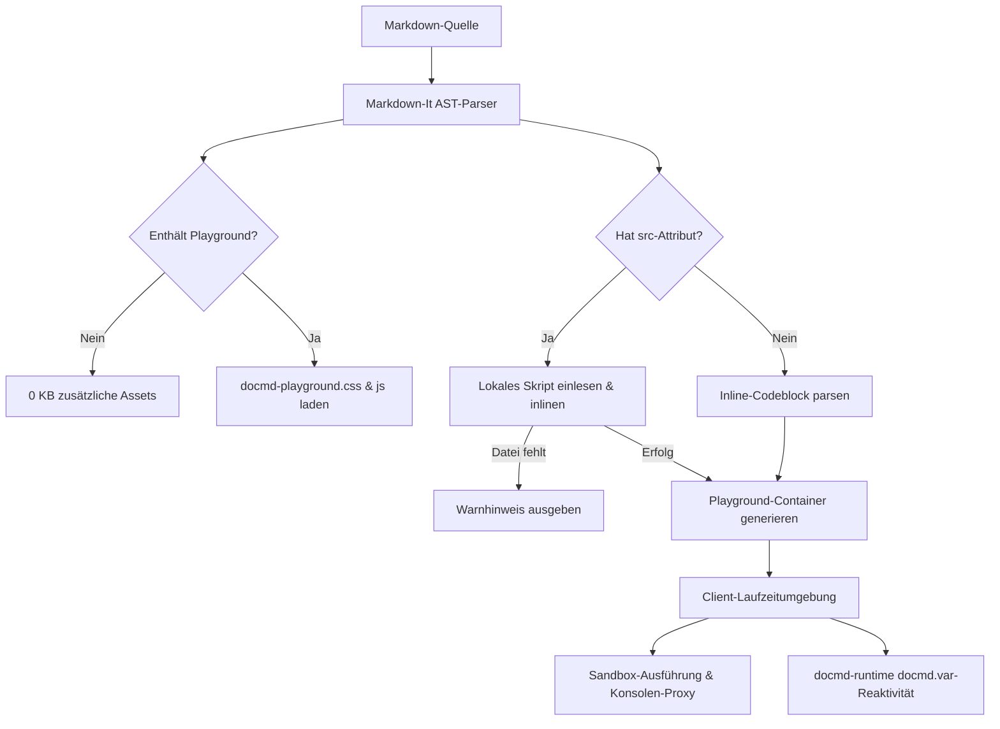

Das `@docmd/plugin-playground`-Plugin bringt interaktive, ausführbare Codeblöcke und Live-Komponentenvorschauen direkt auf Ihre `docmd`-Website. Es ermöglicht Dokumentationsautoren, in sich geschlossene JavaScript-Ausführungen, Live-HTML/CSS-Komponenten und aktive Skriptdateien aus ihrem Repository einzubinden – ohne schwergewichtige Abhängigkeiten wie Monaco oder React.

::: callout success "Kern-Plugin im Lieferumfang von @docmd/core" icon:zap
Ab **v0.9.9** wird `@docmd/plugin-playground` standardmäßig mit `@docmd/core` ausgeliefert und ist standardmäßig aktiviert. Dank des bedingten Asset-Ladens von `docmd` laden Seiten ohne Playground-Blöcke **0 KB zusätzliche Assets**.
:::

## Hauptmerkmale

::: grids
::: card "Zero-Config-Aktivierung" icon:play
Verwenden Sie ```` ```js playground ```` oder `::: playground`, um sofort eine interaktive Sandbox bereitzustellen.
:::
::: card "Aktive Skript-Einbindung" icon:file-code
Verlinken Sie Quellskripte direkt über `::: playground src="./snippets/demo.js" /:::`, um Dokumentationsbeispiele synchron mit dem Projektcode zu halten.
:::
::: card "Echtzeit-Konsolenerfassung" icon:terminal
Fängt `console.log()`, `console.info()`, `console.warn()` und `console.error()` in Echtzeit ab und formatiert Rückgabewerte übersichtlich.
:::
::: card "Live-HTML- & CSS-Sandbox" icon:layout
Rendert interaktive UI-Komponenten in einem isolierten Vorschaufenster mit einfacher Umschaltung zwischen Konsole und Vorschau.
:::
::: card "docmd-runtime-Integration" icon:braces
Direkter Zugriff auf die `window.docmd`-Laufzeitumgebung und reaktive Variablen über `docmd.var.get()` und `docmd.var.set()`.
:::
::: card "Live- & Code-Umschalter" icon:columns
Interaktive Reiter in der Symbolleiste erlauben nahtloses Wechseln zwischen Live-Komponentenvorschau und Quellcode in einer sauberen Einzelfeld-Ansicht (`tabs`).
:::
::: card "Fehlertoleranz & Warnungen" icon:shield-alert
Fehlende Skripte erzeugen ein unaufdringliches Warnbanner mit Fallback-Code; Laufzeitfehler werden strukturiert in der Konsole gemeldet.
:::
::: card "Ultra-Leichtgewicht & Schnell" icon:feather
Reines Standard-JavaScript und CSS (< 10 KB Gesamtgröße) mit Tastaturkürzeln (`Cmd+Enter` / `Ctrl+Enter` zum Ausführen, `Tab` für Einrückung).
:::
:::

## Plugin-Konfiguration

Da `@docmd/plugin-playground` ein Kern-Plugin ist, ist keine Konfiguration erforderlich. Globale Standardwerte können in `docmd.config.json` angepasst oder deaktiviert werden:

```json "docmd.config.json"
{
  "plugins": {
    "playground": {
      "enabled": true,
      "theme": "default",
      "defaultLayout": "split"
    }
  }
}
```

### Konfigurationsoptionen

| Option | Typ | Standard | Beschreibung |
| :--- | :--- | :--- | :--- |
| `enabled` | `boolean` | `true` | Aktiviert oder deaktiviert das Playground-Rendering global. |
| `theme` | `string` | `"default"` | Farbschema passend zum aktiven `docmd`-Layout (`default`, `dark`, `light`). |
| `defaultLayout` | `string` | `"split"` | Standardanordnung (`split` für nebeneinander oder `stacked` für untereinander). |

::: callout tip "Plugin deaktivieren" icon:slash
Um die clientseitige Codeausführung auf der gesamten Website zu deaktivieren, setzen Sie `"playground": false` unter `"plugins"` in `docmd.config.json`. Alle Playground-Blöcke werden dann als standardmäßige Syntax-Codeblöcke dargestellt.
:::

## Technische Architektur & Interna

Das Playground-Plugin basiert auf einer schlanken, abhängigkeitsfreien Architektur:



### 1. Build-Zeit-AST-Verarbeitung
- **Container- & Fence-Hooks**: Registriert Verarbeitungsregeln für `playground` in `markdown-it`.
- **Bedingte Asset-Einbindung**: Nur Seiten mit Playground-Elementen binden die zugehörigen Skripte und Stylesheets ein.

### 2. Skriptauflösung mit `src`
- Löst Pfade relativ zum aktuellen Dokument oder Projektverzeichnis auf.
- Fehlende Dateien führen nicht zum Build-Abbruch, sondern erzeugen strukturierte Warnhinweise (`.docmd-playground-missing-alert`).

### 3. Ausführungssandbox
- Fängt Konsolenaufrufe (`log`, `info`, `warn`, `error`) ab und leitet sie formatiert in das Ausgabefenster weiter.
- Direkte Integration mit der `docmd-runtime` (`docmd.var.get()`, `docmd.var.set()`).

## Skriptbasierte Beispiele & Workflows

### Skript-Beispiel 1: Lokale Skripte einbinden mit `src`

```markdown
::: playground src="./snippets/demo.js" title="Eingebundenes Skript" icon:cpu live /:::
```

::: playground src="./snippets/demo.js" title="Eingebundenes Skript" icon:cpu live /:::

### Skript-Beispiel 2: Headless Live-Vorschau mit `nocode`

````markdown
::: playground tabs nocode preview title="Live-Komponente ohne Code" icon:sparkles live
```html
<div style="padding: 16px; border-radius: 8px; background: #0f172a; border: 1px solid #1e293b; color: #f8fafc; text-align: center;">
  <span style="display:inline-block; padding: 4px 10px; border-radius: 12px; background: #0284c7; color: white; font-size: 11px; font-weight: 700; margin-bottom: 8px;">HEADLESS VORSCHAU</span>
  <p style="margin: 0 0 10px 0; font-size: 13px; color: #94a3b8;">Dieser Playground nutzt <code>nocode</code>, um eine saubere Vorschau ohne Code-Umschalter darzustellen.</p>
  <button style="padding: 6px 16px; background: #10b981; color: white; border: none; border-radius: 6px; font-size: 12px; font-weight: 600; cursor: pointer;" onclick="alert('Interaktion erfolgreich!')">
    Komponente testen
  </button>
</div>
```
:::
````

Live gerendertes Widget:

::: playground tabs nocode preview title="Live-Komponente ohne Code" icon:sparkles live
```html
<div style="padding: 16px; border-radius: 8px; background: #0f172a; border: 1px solid #1e293b; color: #f8fafc; text-align: center;">
  <span style="display:inline-block; padding: 4px 10px; border-radius: 12px; background: #0284c7; color: white; font-size: 11px; font-weight: 700; margin-bottom: 8px;">HEADLESS VORSCHAU</span>
  <p style="margin: 0 0 10px 0; font-size: 13px; color: #94a3b8;">Dieser Playground nutzt <code>nocode</code>, um eine saubere Vorschau ohne Code-Umschalter darzustellen.</p>
  <button style="padding: 6px 16px; background: #10b981; color: white; border: none; border-radius: 6px; font-size: 12px; font-weight: 600; cursor: pointer;" onclick="alert('Interaktion erfolgreich!')">
    Komponente testen
  </button>
</div>
```
:::

### Skript-Beispiel 3: Komponente mit Reiter-Umschaltung (`tabs`)

::: playground tabs preview title="Interaktive Komponente" icon:layout live
```html
<div style="padding: 16px; border-radius: 8px; background: #0f172a; border: 1px solid #1e293b; color: #f8fafc;">
  <p style="margin: 0 0 8px 0; font-size: 13px; color: #38bdf8; font-weight: 600;">Interaktive Sandbox</p>
  <button style="padding: 6px 12px; background: #0284c7; color: white; border: none; border-radius: 4px; font-size: 12px; cursor: pointer;" onclick="console.log('Klick um: ' + new Date().toLocaleTimeString())">
    Zeitstempel in Konsole schreiben
  </button>
</div>
```
:::

## Verwandte Dokumentation

* **[Playground-Container-Dokumentation](../content/containers/playground.md)**: Vollständige Container-Syntax, Reiter, Layout-Optionen und interaktive Beispiele.
* **[Variablen & Personalisierung](../variables/overview.md)**: Integration mit der `docmd-runtime` für clientseitige Reaktivität.
* **[Container-Übersicht](../content/containers/index.md)**: Übersicht aller nativen Container in `docmd`.