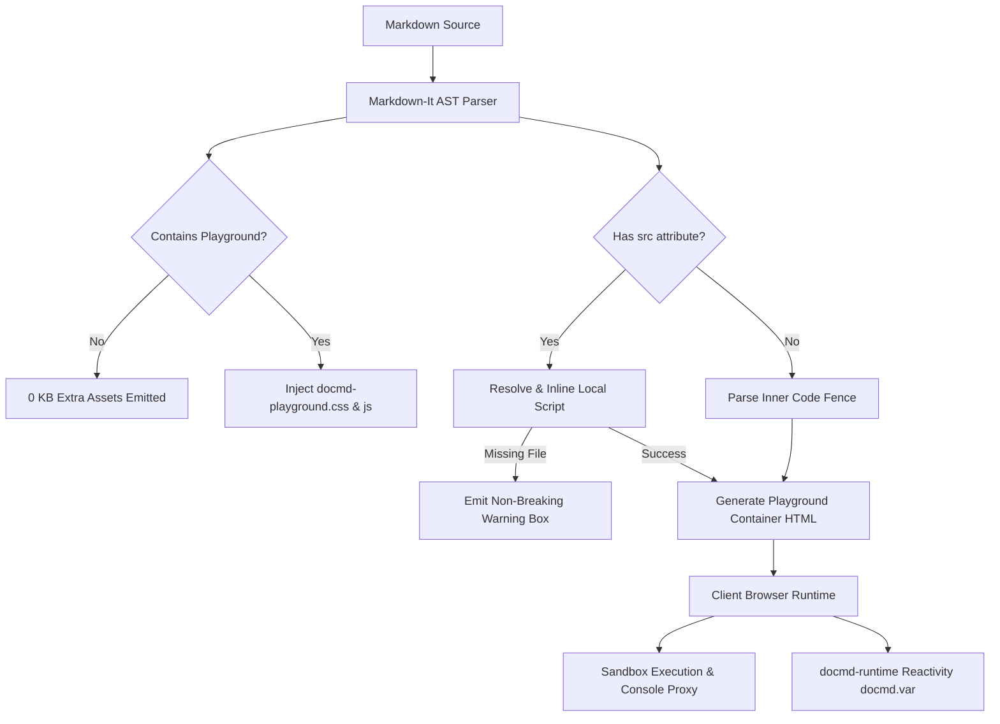

The `@docmd/plugin-playground` plugin brings interactive, runnable code blocks and live component previews directly to your `docmd` site. It enables documentation authors to embed self-contained JavaScript executions, live HTML/CSS components, and active script files from their repository without the bulky dependencies (like Monaco or React) found in heavier documentation frameworks.

::: callout success "Core Plugin Bundled with @docmd/core" icon:zap
Starting in **v0.9.9**, `@docmd/plugin-playground` ships directly with `@docmd/core` and is enabled by default. Thanks to `docmd`'s conditional asset loading, pages without playground blocks load **0 KB of extra assets**, ensuring zero performance impact on static content.
:::

## Key Features

::: grids
::: card "Zero-Config Activation" icon:play
Write code blocks with ```` ```js playground ```` or container blocks with `::: playground` to immediately instantiate an interactive sandbox.
:::
::: card "Active File Embedding" icon:file-code
Point directly to source scripts in your codebase using `::: playground src="./snippets/demo.js" /:::` to keep documentation automatically in sync with real project code.
:::
::: card "Real-Time Console Capture" icon:terminal
Intercepts and formats `console.log()`, `console.info()`, `console.warn()`, and `console.error()` outputs in real time, alongside evaluated return values.
:::
::: card "Live HTML & CSS Sandbox" icon:layout
Renders live HTML/CSS widgets inside an isolated preview panel with tab toggling between console logs and rendered UI.
:::
::: card "docmd-runtime Integration" icon:braces
Direct, native access to the client-side `window.docmd` runtime and reactive page variables via `docmd.var.get()` and `docmd.var.set()`.
:::
::: card "Live & Code View Toggle" icon:columns
Interactive header tabs allow instant switching between running component previews and underlying source code in a clean single-panel view.
:::
::: card "Graceful Warning & Error Handling" icon:shield-alert
Missing scripts render non-breaking warning banners with clean fallback code; runtime exceptions display structured execution notices.
:::
::: card "Ultra-Lightweight & Fast" icon:feather
Pure vanilla JavaScript and CSS (< 10 KB total bundle) with keyboard shortcuts (`Cmd+Enter` / `Ctrl+Enter` to run, `Tab` for indentation).
:::
:::

## Plugin Configuration

Because `@docmd/plugin-playground` is a core plugin, no configuration is required to start using it. However, you can customise global defaults or explicitly disable the plugin in `docmd.config.json`:

```json "docmd.config.json"
{
  "plugins": {
    "playground": {
      "enabled": true,
      "theme": "default",
      "defaultLayout": "split"
    }
  }
}
```

### Configuration Options

| Option | Type | Default | Description |
| :--- | :--- | :--- | :--- |
| `enabled` | `boolean` | `true` | Enables or disables playground rendering globally. |
| `theme` | `string` | `"default"` | Colour theme matching your active `docmd` layout (`default`, `dark`, `light`). |
| `defaultLayout` | `string` | `"split"` | Default layout arrangement (`split` for side-by-side or `stacked` for vertical). |

::: callout tip "Disabling the Plugin" icon:slash
To disable client-side code evaluation across your entire documentation site, set `"playground": false` under `"plugins"` in `docmd.config.json`. All playground code blocks will gracefully fallback to standard syntax-highlighted code blocks, and no playground scripts or stylesheets will be emitted.
:::

## Technical Architecture & Internals

The Playground plugin is engineered around a zero-dependency architecture that keeps documentation pages fast, secure, and light.



### 1. Build-Time AST Interception

During the static site build:
- **Container Hook**: Registers a custom rule on `markdown-it-container` targeting the `playground` keyword.
- **Code Fence Hook**: Inspects code block language identifiers for `playground` or `live` flags (e.g. ```` ```js playground ````).
- **Asset Flagging**: When any playground container or fence is detected on a page, `docmd` flags the document metadata. Only pages with this flag include the `<link>` and `<script>` tags for the playground runtime. Static pages remain 100% clean with **0 KB asset overhead**.

### 2. Script Resolution Engine

When a container specifies an external script path using `src="./..."` or `file="./..."`:
- `docmd` resolves the file path relative to the active Markdown document's directory.
- If not found relative to the document, it falls back to resolving against the project root.
- The script content is read and safely escaped into the code editor DOM element at build time.
- **Graceful Warning Handling**: If the specified script cannot be found (e.g. relocated or deleted during refactoring), the builder does **not** abort. Instead, it generates a structured warning callout (`.docmd-playground-missing-alert`) detailing the missing path and renders empty fallback code, ensuring continuous deployment pipelines never fail due to missing doc snippets.

### 3. Client Runtime & Execution Sandbox

When a user clicks **Run** or executes via keyboard shortcut (<kbd class="docmd-kbd">Cmd</kbd>+<kbd class="docmd-kbd">Enter</kbd> / <kbd class="docmd-kbd">Ctrl</kbd>+<kbd class="docmd-kbd">Enter</kbd>):
- **Console Hijacking**: The runtime instantiates a sandboxed proxy around `console.log`, `console.info`, `console.warn`, and `console.error`. Messages are intercepted, formatted with syntax styling, and appended to the playground's output pane in real time while still mirroring to DevTools if open.
- **Isolated Function Context**: JavaScript is evaluated inside an asynchronous function wrapper with access to `window.docmd` and global browser APIs.
- **HTML/CSS Component Previews**: For HTML snippets, content is rendered into an isolated sandbox panel, enabling full interactive testing of buttons, forms, and custom widgets.


## Script-Based Examples & Workflows

### Script Example 1: Active Codebase Sourcing with `src`

Link directly to real scripts in your repository to eliminate out-of-sync copy-pasting:

```markdown
::: playground src="./snippets/demo.js" title="Active Sourced Script" icon:cpu live /:::
```

When built, `docmd` automatically reads `snippets/demo.js` and embeds it directly into the sandbox:

::: playground src="./snippets/demo.js" title="Active Sourced Script" icon:cpu live /:::

### Script Example 2: Interactive HTML & CSS Component Preview

Playgrounds render rich HTML and CSS components directly in the browser sandbox. Readers view the rendered interface in the **Play** view and can toggle to the **Code** view to inspect or tweak markup:

````markdown
::: playground title="Interactive Notification Card" icon:bell live
```html
<div style="padding: 16px; border-radius: 8px; background: #0f172a; border: 1px solid #1e293b; color: #f8fafc; font-family: system-ui, sans-serif;">
  <div style="display: flex; align-items: center; justify-content: space-between; margin-bottom: 8px;">
    <strong style="color: #38bdf8; font-size: 14px;">Real-Time Notification</strong>
    <span style="font-size: 11px; background: #0369a1; padding: 2px 8px; border-radius: 10px; color: white;">Online</span>
  </div>
  <p style="margin: 0 0 12px 0; font-size: 13px; color: #94a3b8; line-height: 1.4;">
    Toggle between <strong>Play</strong> and <strong>Code</strong> views in the header toolbar to inspect or modify the underlying markup.
  </p>
  <button style="padding: 6px 14px; background: #10b981; color: white; border: none; border-radius: 6px; font-size: 12px; font-weight: 600; cursor: pointer;" onclick="alert('Notification action triggered!')">
    Trigger Action
  </button>
</div>
```
:::
````

Live rendered component:

::: playground title="Interactive Notification Card" icon:bell live
```html
<div style="padding: 16px; border-radius: 8px; background: #0f172a; border: 1px solid #1e293b; color: #f8fafc; font-family: system-ui, sans-serif;">
  <div style="display: flex; align-items: center; justify-content: space-between; margin-bottom: 8px;">
    <strong style="color: #38bdf8; font-size: 14px;">Real-Time Notification</strong>
    <span style="font-size: 11px; background: #0369a1; padding: 2px 8px; border-radius: 10px; color: white;">Online</span>
  </div>
  <p style="margin: 0 0 12px 0; font-size: 13px; color: #94a3b8; line-height: 1.4;">
    Toggle between <strong>Play</strong> and <strong>Code</strong> views in the header toolbar to inspect or modify the underlying markup.
  </p>
  <button style="padding: 6px 14px; background: #10b981; color: white; border: none; border-radius: 6px; font-size: 12px; font-weight: 600; cursor: pointer;" onclick="alert('Notification action triggered!')">
    Trigger Action
  </button>
</div>
```
:::

### Script Example 3: Dynamic Script Execution with Console Logs

Execute JavaScript scripts in a client sandbox with full interception of `console.log`, `console.info`, and return values:

::: playground title="Client Metrics Aggregator" icon:cpu live
```js
const buildYear = window.docmd?.var?.get("docmd.buildYear") || 2026;
const version = window.docmd?.var?.get("docmd.version") || "0.9.9";

console.log("Docmd Engine Version:", version);
console.info("Deployment Build Year:", buildYear);
console.info("Active Runtime Environment: Browser Client Sandbox");

return `System Status: Operational (v${version})`;
```
:::


## Container & Plugin Cross-Reference

* **[Playground Container Documentation](../content/containers/playground.md)**: Explore complete container syntax options, header tabs, layout configurations (`split` vs `stacked`), and Markdown container examples.
* **[Variables & Personalisation Engine](../variables/overview.md)**: Learn how `docmd-runtime` integrates with playground scripts for client-side reactivity.
* **[Containers Overview](../content/containers/index.md)**: Overview of all native containers supported in `docmd`.