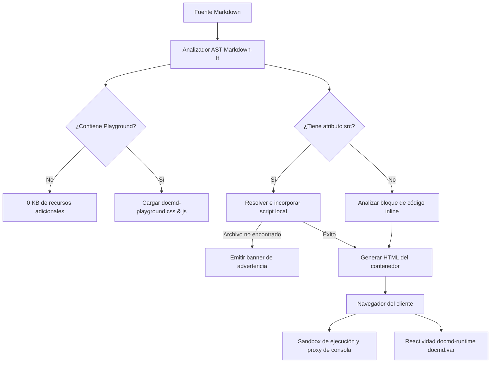

El plugin `@docmd/plugin-playground` incorpora bloques de código ejecutables e interactivos y vistas previas de componentes en vivo directamente en su sitio `docmd`. Permite a los autores de documentación insertar ejecuciones autónomas de JavaScript, componentes HTML/CSS y archivos de script reales de su repositorio sin dependencias pesadas como Monaco o React.

::: callout success "Plugin Principal Incluido con @docmd/core" icon:zap
A partir de **v0.9.9**, `@docmd/plugin-playground` se incluye directamente con `@docmd/core` y está activado de forma predeterminada. Gracias a la carga condicional de recursos de `docmd`, las páginas sin bloques de playground cargan **0 KB de recursos adicionales**.
:::

## Características Principales

::: cards
::: card title="Activación Zero-Config" icon:play
Utilice ` ```js playground ` o `::: playground` para desplegar inmediatamente un entorno interactivo sin configuración previa.
:::
::: card title="Incrustación de Archivos Activos" icon:file-code
Vincule scripts reales de su repositorio mediante `::: playground src="./counter.js" /:::` para mantener la documentación sincronizada automáticamente con el proyecto.
:::
::: card title="Captura de Consola en Tiempo Real" icon:terminal
Intercepta `console.log()`, `console.info()`, `console.warn()` y `console.error()` en tiempo real y muestra los valores devueltos de forma clara.
:::
::: card title="Sandbox de HTML y CSS en Vivo" icon:layout
Renderiza componentes visuales en un panel de vista previa aislado con alternancia sencilla entre consola y vista previa.
:::
::: card title="Integración con docmd-runtime" icon:braces
Acceso directo al entorno de ejecución `window.docmd` y a las variables reactivas mediante `docmd.var.get()` y `docmd.var.set()`.
:::
::: card title="Selector de Vista Live y Code" icon:columns
Pestañas interactivas en la barra de herramientas superior para alternar fluidamente entre la salida visual y el código fuente (`tabs`).
:::
::: card title="Tolerancia a Fallos y Avisos" icon:shield-alert
Los scripts faltantes muestran un banner de aviso sin interrumpir la compilación; las excepciones de ejecución se reportan con claridad en la consola.
:::
::: card title="Ultra Ligero y Rápido" icon:feather
Construido exclusivamente con JavaScript y CSS estándar (< 10 KB en total) con atajos de teclado (`Cmd+Enter` / `Ctrl+Enter` para ejecutar, `Tab` para sangría).
:::
:::

## Configuración del Plugin

Al ser un plugin principal, no se requiere configuración para comenzar a utilizarlo. No obstante, puede personalizar los ajustes globales o desactivarlo en `docmd.config.json`:

```json "docmd.config.json"
{
  "plugins": {
    "playground": {
      "enabled": true,
      "theme": "default",
      "defaultLayout": "split"
    }
  }
}
```

### Opciones de Configuración

| Opción | Tipo | Valor Predeterminado | Descripción |
| :--- | :--- | :--- | :--- |
| `enabled` | `boolean` | `true` | Habilita o deshabilita la generación de playgrounds de forma global. |
| `theme` | `string` | `"default"` | Tema visual según el diseño de `docmd` activo (`default`, `dark`, `light`). |
| `defaultLayout` | `string` | `"split"` | Disposición predeterminada (`split` para lado a lado o `stacked` para vertical). |

::: callout tip "Desactivación del Plugin" icon:slash
Para desactivar la ejecución de código en el cliente en todo el sitio, configure `"playground": false` bajo `"plugins"` en `docmd.config.json`. Todos los bloques de playground se representarán como bloques de código resaltados estándar.
:::

## Arquitectura Técnica e Información Interna

El plugin Playground está diseñado con una arquitectura ligera sin dependencias externas:



### 1. Intercepción AST en Tiempo de Compilación
- **Ganchos de Contenedor y Bloques**: Registra reglas de procesamiento para `playground` en `markdown-it`.
- **Carga Condicional de Recursos**: Solo las páginas que contienen bloques de playground inyectan los estilos y scripts correspondientes.

### 2. Motor de Resolución de Scripts con `src`
- Resuelve rutas relativas al documento activo o a la raíz del proyecto.
- Si un archivo no se encuentra, genera una alerta estructurada (`.docmd-playground-missing-alert`) sin detener el proceso de compilación.

### 3. Entorno de Ejecución Sandbox
- Intercepta llamadas a `console.log`, `info`, `warn` y `error`, mostrándolas con formato en el panel de resultados.
- Totalmente integrado con `docmd-runtime` (`docmd.var.get()`, `docmd.var.set()`).

## Ejemplos Basados en Scripts y Flujos de Trabajo

### Ejemplo de Script 1: Enlace a Scripts Locales con `src`

```markdown
::: playground src="./snippets/counter.js" title="Script Vinculado" icon:cpu live /:::
```

::: playground src="./snippets/counter.js" title="Script Vinculado" icon:cpu live /:::

### Ejemplo de Script 2: Variables Reactivas en Scripts

```js playground title="Inspector de Variables" icon:braces live
const version = docmd.var.get("docmd.version");
console.log("Versión de docmd:", version);
docmd.var.set("user.plan", "Pro");
console.info("Plan actualizado:", docmd.var.get("user.plan"));
return `Versión activa: ${version}`;
```

### Ejemplo de Script 3: Componente con Pestañas (`tabs`)

::: playground tabs title="Componente Interactivo" icon:layout live
```html
<div style="padding: 16px; border-radius: 8px; background: #0f172a; border: 1px solid #1e293b; color: #f8fafc;">
  <p style="margin: 0 0 8px 0; font-size: 13px; color: #38bdf8; font-weight: 600;">Componente en Vivo</p>
  <button style="padding: 6px 12px; background: #0284c7; color: white; border: none; border-radius: 4px; font-size: 12px; cursor: pointer;" onclick="console.log('Clic a las: ' + new Date().toLocaleTimeString())">
    Registrar Hora en Consola
  </button>
</div>
```
:::

## Documentación Relacionada

* **[Documentación del Contenedor Playground](../content/containers/playground.md)**: Sintaxis completa de contenedores, pestañas, opciones de diseño y ejemplos.
* **[Variables y Personalización](../variables/overview.md)**: Integración con `docmd-runtime` para reactividad en cliente.
* **[Resumen de Contenedores](../content/containers/index.md)**: Catálogo de todos los contenedores nativos en `docmd`.