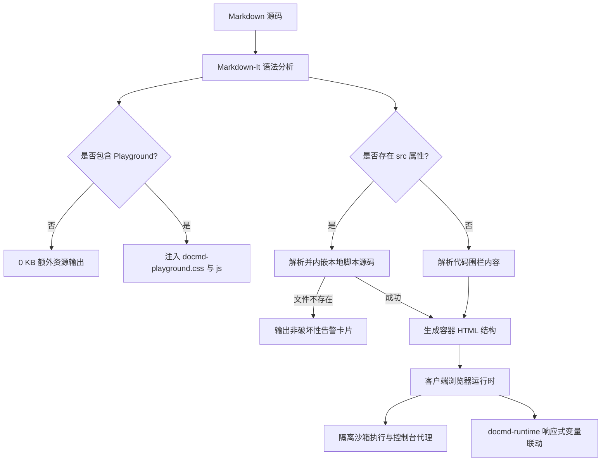

`@docmd/plugin-playground` 插件为 `docmd` 站点带来交互式、可运行的代码块与实时组件预览。文档作者可以直接在文档中嵌入独立的 JavaScript 执行环境、实时 HTML/CSS 组件以及代码库中的真实脚本文件，而无需引入 Monaco 或 React 等庞大的第三方依赖。

::: callout success "内置于 @docmd/core 的核心插件" icon:zap
自 **v0.9.9** 起，`@docmd/plugin-playground` 直接随 `@docmd/core` 分发并默认启用。得益于 `docmd` 的按需资产加载机制，未包含演练场代码块的页面加载 **0 KB 额外资产**，确保静态内容的极致性能。
:::

## 核心特性

::: grids
::: card "Zero-Config 零配置激活" icon:play
在文档中编写 ```` ```js playground ```` 或 `::: playground`，即可立即实例化一个交互式沙箱。
:::
::: card "代码库文件动态嵌入" icon:file-code
通过 `::: playground src="./snippets/demo.js" /:::` 直接引用代码库中的源脚本，确保文档示例随实际项目代码自动保持同步。
:::
::: card "控制台日志实时捕获" icon:terminal
实时拦截并格式化 `console.log()`、`console.info()`、`console.warn()` 和 `console.error()` 输出，并直观展示返回值。
:::
::: card "实时 HTML & CSS 组件沙箱" icon:layout
在隔离的预览框架内渲染动态 UI 组件，并支持在控制台日志与渲染视图之间便捷切换。
:::
::: card "docmd-runtime 深度集成" icon:braces
原生访问客户端 `window.docmd` 运行时与响应式页面变量，支持 `docmd.var.get()` 和 `docmd.var.set()`。
:::
::: card "Live 与 Code 视图切换" icon:columns
在顶栏提供交互式选项卡，可在组件实时渲染输出与底层源代码之间即刻在全宽单面板视图中切换（`tabs`）。
:::
::: card "优雅错误降级与提示" icon:shield-alert
引用的脚本缺失时显示不影响构建的友好警告横幅；代码运行抛出异常时在控制台清晰呈现错误信息。
:::
::: card "超轻量与极致速度" icon:feather
纯原生 JavaScript 与 CSS 构建（整体体积 < 10 KB），支持常用键盘快捷键（`Cmd+Enter` / `Ctrl+Enter` 运行，`Tab` 缩进）。
:::
:::

## 插件配置

由于 `@docmd/plugin-playground` 属于核心插件，默认开箱即用，无需额外配置。您亦可在 `docmd.config.json` 中自定义全局选项或显式关闭插件：

```json "docmd.config.json"
{
  "plugins": {
    "playground": {
      "enabled": true,
      "theme": "default",
      "defaultLayout": "split"
    }
  }
}
```

### 配置项说明

| 选项 | 类型 | 默认值 | 描述 |
| :--- | :--- | :--- | :--- |
| `enabled` | `boolean` | `true` | 全局开启或关闭演练场渲染。 |
| `theme` | `string` | `"default"` | 匹配当前 `docmd` 布局的配色主题（`default`, `dark`, `light`）。 |
| `defaultLayout` | `string` | `"split"` | 默认排版形式（`split` 为左右分栏，`stacked` 为上下堆叠）。 |

::: callout tip "禁用插件" icon:slash
若需要在整个文档站点禁用客户端代码求值，请在 `docmd.config.json` 的 `"plugins"` 下设置 `"playground": false`。所有演练场代码块将优雅降级为带语法高亮的基础代码块，且不会注入任何演练场脚本或样式。
:::

## 技术架构与内部原理

Playground 插件采用轻量、无外部依赖的架构设计，确保文档站点的高性能与安全性：



### 1. 构建期 AST 拦截机制
- **容器与代码围栏钩子**：在 `markdown-it` 中注册针对 `playground` 的处理规则。
- **按需条件资源加载**：仅在包含 Playground 容器或代码块的页面上注入相关样式与脚本，未使用的静态页面保持 100% 纯净，**0 KB 额外体积**。

### 2. 源码脚本解析引擎 (`src`)
- 自动相对于当前文档目录或项目根目录解析本地文件路径。
- 若目标文件丢失，构建器不会中断报错，而是渲染清晰的告警提示框（`.docmd-playground-missing-alert`），保证 CI/CD 构建流程顺利通过。

### 3. 沙箱执行环境
- 代理拦截 `console.log`、`console.info`、`console.warn`、`console.error`，实时格式化输出到控制台面板。
- 原生集成 `docmd-runtime`（`docmd.var.get()`、`docmd.var.set()`）。

## 脚本驱动示例与工作流

### 脚本示例 1：引用本地脚本源码 (`src`)

```markdown
::: playground src="./snippets/demo.js" title="本地脚本文件" icon:cpu live /:::
```

::: playground src="./snippets/demo.js" title="本地脚本文件" icon:cpu live /:::

### 脚本示例 2：无代码纯预览模式 (`nocode`)

当展示交互式设计组件或小部件且无需用户查看代码时，结合使用 `tabs` 与 `nocode`（或 `code:false`）可隐藏代码查看按钮：

````markdown
::: playground tabs nocode preview title="实时无代码组件" icon:sparkles live
```html
<div style="padding: 16px; border-radius: 8px; background: #0f172a; border: 1px solid #1e293b; color: #f8fafc; text-align: center;">
  <span style="display:inline-block; padding: 4px 10px; border-radius: 12px; background: #0284c7; color: white; font-size: 11px; font-weight: 700; margin-bottom: 8px;">无代码预览</span>
  <p style="margin: 0 0 10px 0; font-size: 13px; color: #94a3b8;">该 Playground 使用 <code>nocode</code> 渲染整洁的交互组件，无代码按钮干扰。</p>
  <button style="padding: 6px 16px; background: #10b981; color: white; border: none; border-radius: 6px; font-size: 12px; font-weight: 600; cursor: pointer;" onclick="alert('组件点击触发成功！')">
    测试组件交互
  </button>
</div>
```
:::
````

实时渲染的组件预览：

::: playground tabs nocode preview title="实时无代码组件" icon:sparkles live
```html
<div style="padding: 16px; border-radius: 8px; background: #0f172a; border: 1px solid #1e293b; color: #f8fafc; text-align: center;">
  <span style="display:inline-block; padding: 4px 10px; border-radius: 12px; background: #0284c7; color: white; font-size: 11px; font-weight: 700; margin-bottom: 8px;">无代码预览</span>
  <p style="margin: 0 0 10px 0; font-size: 13px; color: #94a3b8;">该 Playground 使用 <code>nocode</code> 渲染整洁的交互组件，无代码按钮干扰。</p>
  <button style="padding: 6px 16px; background: #10b981; color: white; border: none; border-radius: 6px; font-size: 12px; font-weight: 600; cursor: pointer;" onclick="alert('组件点击触发成功！')">
    测试组件交互
  </button>
</div>
```
:::

### 脚本示例 3：双模视图切换组件 (`tabs`)

::: playground tabs preview title="可切换组件预览" icon:layout live
```html
<div style="padding: 16px; border-radius: 8px; background: #0f172a; border: 1px solid #1e293b; color: #f8fafc;">
  <p style="margin: 0 0 8px 0; font-size: 13px; color: #38bdf8; font-weight: 600;">交互式组件</p>
  <button style="padding: 6px 12px; background: #0284c7; color: white; border: none; border-radius: 4px; font-size: 12px; cursor: pointer;" onclick="console.log('点击时间: ' + new Date().toLocaleTimeString())">
    输出时间戳到控制台
  </button>
</div>
```
:::

## 关联文档与参考

* **[Playground 容器语法与属性指南](../content/containers/playground.md)**：深入了解容器标签属性、Live/Code 视图切换、布局排列及更多实时示例。
* **[变量与个性化运行时](../variables/overview.md)**：了解 `docmd-runtime` 如何与客户端脚本响应联动。
* **[容器组件全览](../content/containers/index.md)**：查看 `docmd` 支持的完整容器清单。